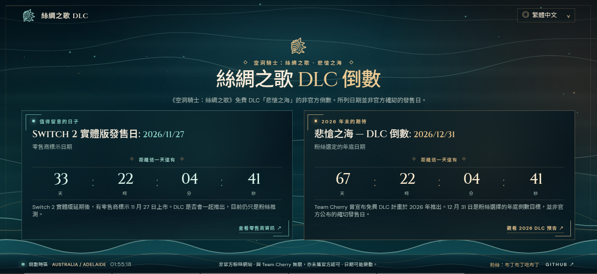
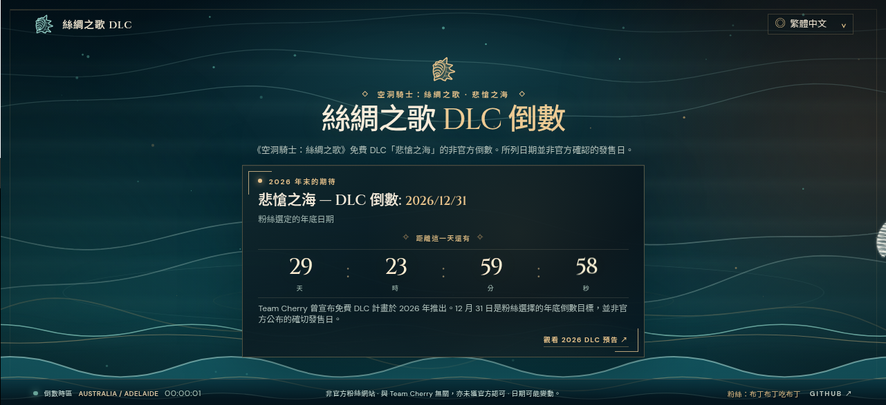
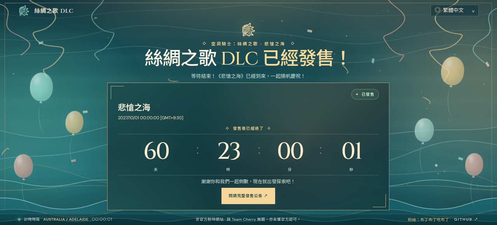
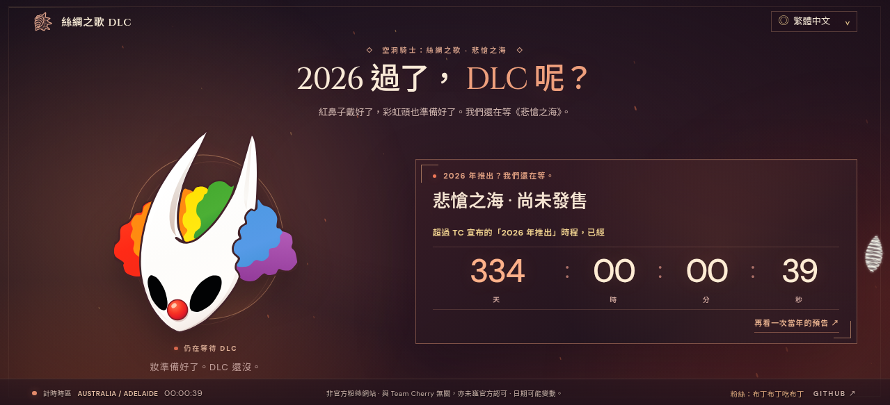

# 等待漫長時光 — 絲綢之歌 DLC 倒數

[English](./README.md) · [繁體中文](./README_zh_tw.md)

[](https://github.com/pulipulichen/silksong-dlc-countdown/actions/workflows/deploy.yml)

**[開啟網站](https://pulipulichen.github.io/silksong-dlc-countdown/)**

這是一個結合深海動畫與多語系的**非官方粉絲倒數網站**，用四種不同畫面記錄等待《空洞騎士：絲綢之歌》免費 DLC《悲愴之海》的過程：雙重倒數、年底倒數、正式發售慶祝，以及逾期仍未發售的幽默場景。使用 Vite、TypeScript、CSS 與 Canvas 製作，不需要後端，也不使用官方遊戲美術素材。

## 四種可能的未來：畫面展示

等待《悲愴之海》的日子，會迎來什麼結局？本網站不只是一個倒數計時器，而是會隨著日期與 DLC 發售狀態，切換不同版面、配色與動畫，呈現粉絲等待的心情。

> **畫面情境模擬：** 以下四張截圖使用模擬日期與手動設定的 DLC 發售狀態展示功能，**不代表 DLC 已發售、確定延期或官方公布發售日期**。網站不會自動向官方查證發售消息。

### 1. 雙重倒數：兩個值得關注的日期



在 2026 年 11 月底之前，畫面會同時顯示兩張倒數卡片：

- **2026/11/27：** 零售商標示的 Switch 2 實體版發售參考日期。
- **2026/12/31：** 粉絲選定的《悲愴之海》DLC 年底倒數目標。

兩組計時器都會持續顯示剩餘天、時、分、秒。**Switch 2 實體版的日期並不是 DLC 官方發售日**，兩者可能同日推出僅屬粉絲猜測。

### 2. 年底倒數：只剩下《悲愴之海》



到了阿德雷德時間 **2026/11/28**，Switch 2 實體版的參考日期已過，對應卡片會隱藏，畫面中央只留下《悲愴之海》的倒數。搭配青綠色深海、流動波浪與漂浮光點，將焦點留給 DLC。

**12 月 31 日僅是粉絲選擇的 2026 年底標記，不是 Team Cherry 確認的發售日。**

### 3. DLC 已經發售：一起慶祝！



假如 DLC 正式推出，維護者可以手動將 `dlcReleased` 設為 `true`、填入已確認的發售時間，並可設定官方公告連結。網站就會切換成氣球、彩帶與明亮青綠配色的慶祝場景，並且**從設定的發售時刻開始正向累計時間**，記錄玩家期待成真的每一天。

**這張是模擬發售後的示意圖，並非 DLC 已正式發售的消息。** 畫面切換不會自動偵測官方公告。

### 4. 2026 都過了，DLC 呢？



如果阿德雷德時間進入 **2027/01/01**，DLC 卻仍未發售，網站將從深海青綠切換成暗紅色系，出現帶點自嘲的小丑風格粉絲插畫，以及「2026 過了，DLC 呢？」的幽默標題。原本的倒數會變成**從 2027 年開始計算的逾期累計時間**。

這是對漫長等待的善意玩笑，**不代表官方曾承諾在 12 月 31 日發售**。

## 兩個日期

| 目標時間（澳洲／阿德雷德午夜） | 說明 |
| --- | --- |
| **2026-12-31 00:00** | 粉絲選定的《Sea of Sorrow》DLC 年底標記。Team Cherry 宣布免費擴充內容預計於 **2026** 推出，**並未確認 12 月 31 日為發售日**。[Team Cherry 公告](https://www.teamcherry.com.au/blog/holiday2025) · [DLC 預告（0:28）](https://youtu.be/qDFEeeLy6ws?t=28)。 |
| **2026-11-27 00:00** | 零售商標示的延期後 **Switch 2 實體版**發售日期。DLC 是否會同日推出仍是**未經確認的粉絲推測**。[零售商頁面](https://www.tvgame.com.tw/SalePage/Index/11873934?lang=zh-TW)。 |

兩個倒數都使用 IANA **Australia/Adelaide** 時區，並包含日光節約時間。日期過後，計時器會顯示日期已到，並改為累計已經過的天數、時數、分鐘與秒數。

## 可安裝的 PWA（僅限線上使用）

安裝後的 App 名稱為 **Silksong DLC Countdown**（`name`）／**Silksong DLC**（`short_name`），而非 Sea of Sorrow。網站提供 Web App Manifest，並可在相容瀏覽器中以獨立 App 方式安裝。在 Android 上，使用瀏覽器的**安裝應用程式**或**新增至主畫面**；在 iOS 上，使用 Safari 的**加入主畫面**。各瀏覽器的安裝支援狀況不同。Chromium 觸發可安裝事件時，桌面版會在右下角、手機版會在畫面中央顯示小型邀請卡，提供**立即安裝**與**稍後再說**。關閉邀請後 24 小時內不會再次顯示。iOS Safari 則會顯示簡短的**分享 → 加入主畫面**提示；已安裝的獨立 App 不會顯示邀請卡。邀請卡會配合網站所選語言。

**使用本網站需要網際網路連線。**本專案刻意不註冊 Service Worker，也不使用 Workbox、離線預快取或離線備援頁面。瀏覽器仍可能使用一般 HTTP 快取，但本網站並非離線優先應用程式。App Manifest 的範圍限定在 GitHub Pages 專案子路徑。

GitHub Actions 會從 `public/favicon.svg` 產生不透明背景的 PNG 安裝圖示：192×192 與 512×512 標準圖示、具有安全留白的 512×512 Android 遮罩圖示，以及 180×180 Apple 觸控圖示。修改 SVG 即可一起更新所有圖示；每次正式建置時，`scripts/render-icons.mjs` 都會將圖示產生到 `dist/`。

## 功能

- 桌面與手機版的單畫面自適應版面。
- 兩個即時倒數／經過時間計時器，可在程式碼中設定模擬時間與 DLC 發佈狀態。
- 自動偵測瀏覽器語言並記住選擇：英文、繁體中文、簡體中文、日文。
- 原創的青綠與金色 Canvas 粒子、發光弧線、指標視差、觸控火花與數字動畫。
- 支援減少動態效果設定，並降低手機版粒子數量。
- 來源連結、粉絲網站免責聲明、GitHub 連結與社群分享預覽圖。

## 在程式碼中設定模擬時間與 DLC 發佈狀態

修改 `src/main.ts` 前段的 `simulationSettings` 設定物件。這些參數只在程式碼中設定，不會顯示成網站上的控制項：

- `mode: "auto"` 使用目前真實時間；改成 `"custom"` 就會模擬指定日期。
- `date` 使用 `YYYY-MM-DD` 格式。模擬會從**澳洲／阿德雷德時間午夜 00:00**開始，並從每次載入頁面時開始依真實時間前進。
- `dlcReleased: true` 會切換至對應語言的 DLC 發售慶祝畫面；`false` 則維持倒數或逾期畫面。將 `dlcReleasedAt` 設為包含明確時區的實際發售時間（`Z` 或 UTC 時差），即可開始累計發售後經過時間。若時間留空或格式無效，計時器會顯示未設定（`--`），不會捏造發售時間。
- `dlcAnnouncementUrl` 可設定絕對 `http://` 或 `https://` 公告網址，顯示公告按鈕；留空則隱藏按鈕。

例如，要預覽 **2026-12-01** 並啟用發售畫面，將設定物件改成以下內容。尚未設定實際發售時間前，經過時間會保持未設定：

```ts
const simulationSettings: SimulationSettings = {
  mode: "custom",
  date: "2026-12-01",
  dlcReleased: true,
};
```

要恢復真實時間，將 `mode` 改回 `"auto"`。儲存程式碼後，需重新建置／部署，公開網站才會套用設定。

## GitHub Actions 自動建置與部署

**發布網站不需要在你的電腦下載、安裝或編譯任何東西。**

每次推送到 `main` 時，GitHub-hosted runner 都會自動執行[部署至 GitHub Pages](https://github.com/pulipulichen/silksong-dlc-countdown/actions/workflows/deploy.yml)：

1. Checkout 專案，並在 **GitHub Actions** 上安裝 Node.js 22。
2. 在 **GitHub Actions** 上安裝 npm 相依套件。
3. 在 **GitHub Actions** 上執行 `npm run build`（TypeScript 檢查、Vite 正式建置與社群預覽圖產生）。
4. 驗證產生的靜態檔案，並將 `dist/` 部署至 GitHub Pages。

網站：**https://pulipulichen.github.io/silksong-dlc-countdown/**

如有需要，請先到 **Settings → Pages → Build and deployment → Source: GitHub Actions** 啟用一次。也可以在 **Actions → Deploy to GitHub Pages → Run workflow** 手動啟動工作流程。

## Google Play AAB（僅使用 GitHub Actions）

Android 版本使用 Trusted Web Activity（TWA）開啟現有的線上網站，不包含小工具或通知。套件 ID 為 `io.github.pulipulichen.silksongdlccountdown`，發布後請勿變更。不需要 Android SDK，也不需要在本機編譯。

**一次性簽署設定：**在安全的環境中建立長期使用的上傳金鑰庫，並在 GitHub 以外妥善備份。接著到儲存庫的 **Settings → Secrets and variables → Actions → Secrets** 新增三個 secret：

- `ANDROID_KEYSTORE_BASE64`：二進位 JKS／PKCS12 上傳金鑰庫的 Base64 編碼（單行）。
- `ANDROID_KEYSTORE_PASSWORD`：金鑰庫密碼。
- `ANDROID_KEY_PASSWORD`：上傳金鑰密碼。

金鑰別名必須是 **`upload`**。以下指令範例只需在可信任的環境執行一次；請勿提交產生的檔案：

```sh
keytool -genkeypair -v -keystore release.keystore -alias upload -keyalg RSA -keysize 2048 -validity 10000
base64 -w0 release.keystore
```

請妥善保存原始金鑰庫與密碼。Google Play App Signing 使用的是你的上傳金鑰，不是 Google 的 App 簽署金鑰。

前往 **Actions → Build Google Play AAB → Run workflow**，輸入唯一且遞增的 `version_code`（首次上傳使用 1，下一次使用 2，以此類推）與 `version_name`。工作成功後，下載 **silksong-dlc-countdown-aab** artifact，並將 `.aab` 上傳到 Google Play Console。Artifact 保留三天。此工作流程刻意不會直接發布到 Google Play。

**全螢幕 TWA 的必要設定：**在網站根網域 `https://pulipulichen.github.io/.well-known/assetlinks.json` 設定 Digital Asset Links，內容包含 `delegate_permission/common.handle_all_urls`、上述套件 ID，以及 **Google Play App 簽署憑證的 SHA-256**（可在 Play Console → App integrity 找到）。GitHub Pages 專案網站無法從這個儲存庫的子路徑獨立提供根網域的 `/.well-known/` 檔案。擁有者需設定根網域，或改用可自行管理的網域。若未成功驗證，Chrome 可能會顯示網址列，而不是全螢幕 TWA。上傳金鑰的指紋不一定等於 Play App 簽署金鑰的指紋。

## 使用 Podman 在本機測試（選用）

**部署不需要在本機測試。**若想在本機預覽，可使用 Podman 在容器內完成建置，不需在主機安裝 Node.js 或 npm：

```bash
podman build -t silksong-dlc-countdown -f Containerfile .
podman run --rm -p 8080:80 silksong-dlc-countdown
```

預覽網址：http://localhost:8080/silksong-dlc-countdown/

若要在編輯程式碼時使用 Vite 熱更新，請執行 `./start.sh`（需要 Podman）。此腳本會建置開發映像，並將專案原始碼掛載至容器，使用相同的預覽網址。

## 修改程式內建的倒數日期或翻譯

要設定模擬時間或 DLC 發佈狀態，請依上方說明修改 `src/main.ts` 的 `simulationSettings`。要修改網站內建的目標日期或倒數邏輯，也請編輯 `src/main.ts`；要修改翻譯則編輯 `src/i18n.ts`。將程式碼變更提交到 `main` 後，GitHub Actions 會負責建置與部署。

**免責聲明：**這是非官方粉絲專案，與 Team Cherry 無關。兩個日期都不是已確認的 DLC 發售日期。
