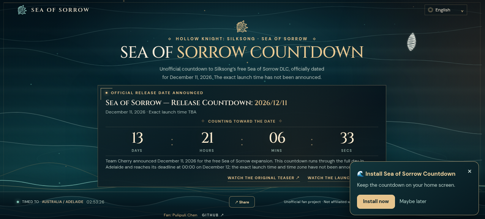

# 悲愴之海 — 絲綢之歌 DLC 倒數

[English](./README.md) · [繁體中文](./README_zh_tw.md)

**[開啟網站](https://pulipulichen.github.io/silksong-dlc-countdown/)**

這是一個結合深海動畫與多語系的**非官方粉絲倒數網站**，用來記錄等待《空洞騎士：絲綢之歌》免費 DLC《悲愴之海》的過程。Team Cherry 已公布免費擴充內容《悲愴之海》將於 **2026 年 12 月 11 日推出**，但沒有公布具體開放時間與時區。

## 目前倒數設定

- **官方公布發售日期：** 2026/12/11。
- **具體開放時間：** 尚未公布。
- **倒數期限：** **阿德雷德時間 2026/12/12 00:00**（相當於台灣時間 12/11 21:30），也就是 12 月 11 日結束的那一刻。因此倒數會完整涵蓋 12 月 11 日；這不代表 DLC 會在午夜開放。
- **逾時計時：** 若到了阿德雷德倒數期限仍未標記為已發售，逾時計時就會從該時間界線開始，直到台灣時間的自動切換時間。

> `demo/` 中的歷史倒數版面與逾期／發售狀態預覽，請參閱[Demo 畫面歷史紀錄](./docs/zh_tw/demo-history.md)。這些圖片是歷史紀錄或模擬預覽，不全都代表目前公開網站的即時畫面。

## 網站的三種狀態

1. **《悲愴之海》倒數。** 網站只保留一張倒數卡片，完整倒數 12 月 11 日，並於阿德雷德時間 12 月 12 日 00:00（12 月 11 日結束時）到期。
2. **逾期等待。** 若到了阿德雷德倒數期限仍未標記為已發售，網站就會切換成逾期畫面，從同一個時間界線開始累計。
3. **發售慶祝。** 網站會在台灣時間 2026/12/12 00:00 自動切換為發售慶祝畫面，並從這個預定時間開始累計。若官方確認 DLC 會更早開放，維護者也可以將 `dlcReleased: true`，並更新發售時間。

## 官方日期

| 日期 | 說明 |
| --- | --- |
| **2026/12/11** | Team Cherry 公布的《悲愴之海》DLC 發售日期。具體開放時間與時區尚未公布；倒數期限為阿德雷德時間 12/12 00:00，也就是 12/11 結束時。 |

官方公布的發售日期與倒數期限使用 IANA **Australia/Adelaide** 時區，並包含日光節約時間；網站自動切換則使用 **Asia/Taipei（台灣時間 UTC+8）**。

## 官方預告

- [首支預告](https://www.youtube.com/watch?v=qDFEeeLy6ws)
- [發售預告](https://www.youtube.com/watch?v=7hj4g173FhM)

## 可安裝的 PWA（僅限線上使用）

安裝後的 App 名稱為 **Sea of Sorrow Countdown**（`name`）／**Sea of Sorrow**（`short_name`）。網站提供 Web App Manifest，並可在相容瀏覽器中以獨立 App 方式安裝。在 Android 上，使用瀏覽器的**安裝應用程式**或**新增至主畫面**；在 iOS 上，使用 Safari 的**加入主畫面**。各瀏覽器的安裝支援狀況不同。Chromium 觸發可安裝事件時，桌面版會在右下角、手機版會在畫面中央顯示小型邀請卡，提供**立即安裝**與**稍後再說**。關閉邀請後 24 小時內不會再次顯示。iOS Safari 則會顯示簡短的**分享 → 加入主畫面**提示；已安裝的獨立 App 不會顯示邀請卡。邀請卡會配合網站所選語言。

**使用本網站需要網際網路連線。** 本專案刻意不註冊 Service Worker，也不使用 Workbox、離線預快取或離線備援頁面。瀏覽器仍可能使用一般 HTTP 快取，但本網站並非離線優先應用程式。App Manifest 的範圍限定在 GitHub Pages 專案子路徑。

GitHub Actions 會從 `public/favicon.svg` 產生不透明背景的 PNG 安裝圖示：192×192 與 512×512 標準圖示、具有安全留白的 512×512 Android 遮罩圖示，以及 180×180 Apple 觸控圖示。修改 SVG 即可一起更新所有圖示；每次正式建置時，`scripts/render-icons.mjs` 都會將圖示產生到 `dist/`。

## 功能

- 桌面與手機版的自適應單畫面版面。
- 即時倒數與經過時間計時器。
- 自動偵測瀏覽器語言並記住選擇：英文、繁體中文、簡體中文、日文。
- 原創的青綠與金色 Canvas 粒子、發光弧線、指標視差、觸控火花與數字動畫。
- 支援減少動態效果設定，並降低手機版粒子數量。
- 來源連結、粉絲網站免責聲明、GitHub 連結與社群分享預覽圖。

## 維護者文件

- [倒數日期與 DLC 設定](./docs/zh_tw/configuration.md)
- [部署與本機測試](./docs/zh_tw/deploy.md)
- [Google Play AAB 設定](./docs/zh_tw/google_play.md)
- [Demo 畫面歷史紀錄](./docs/zh_tw/demo-history.md)

**免責聲明：** 這是非官方粉絲專案，與 Team Cherry 無關。
