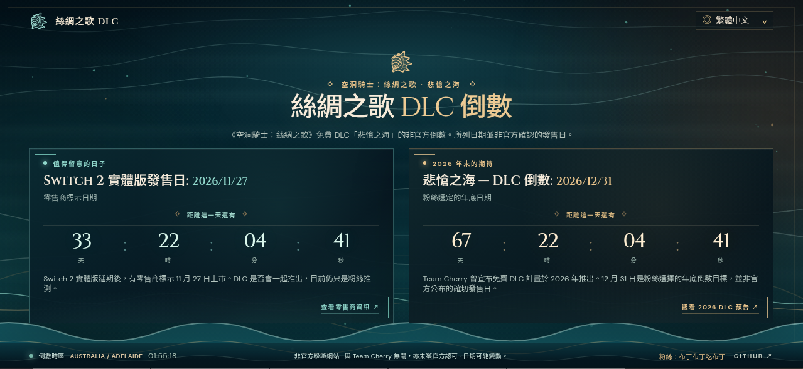
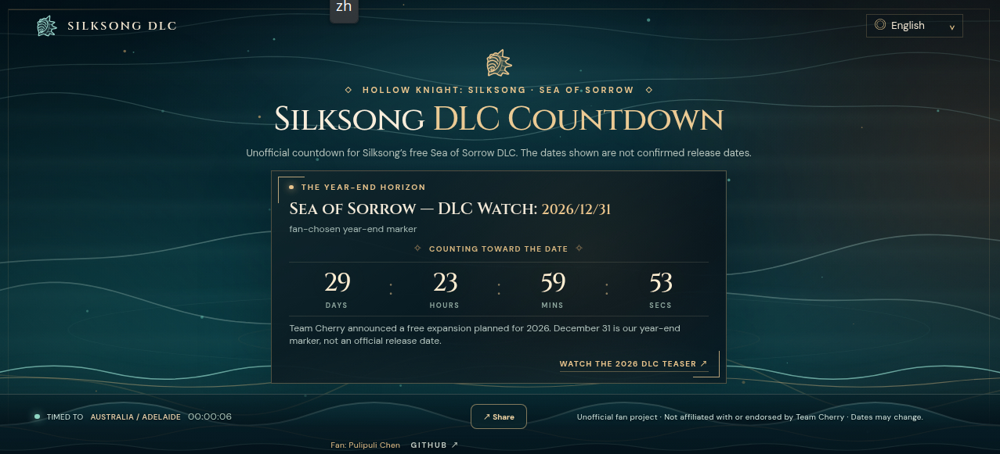
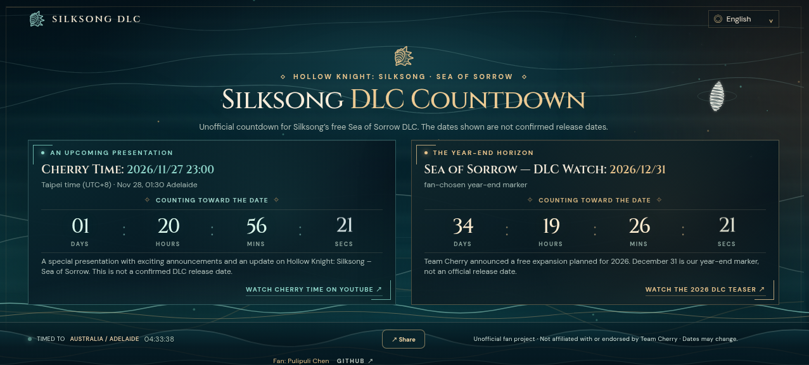
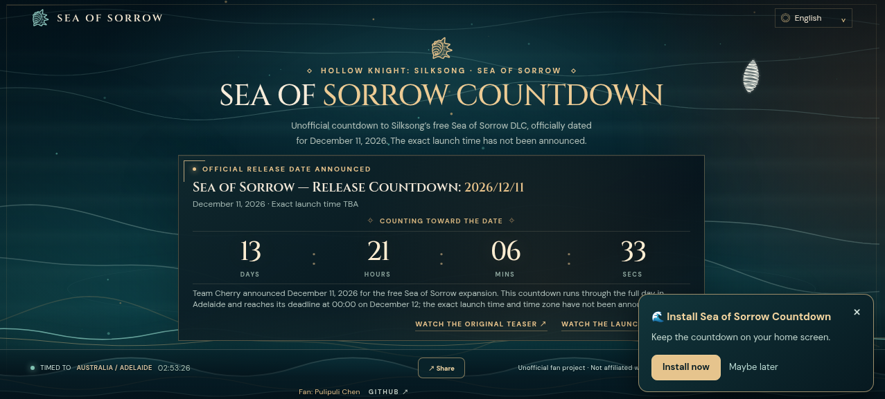
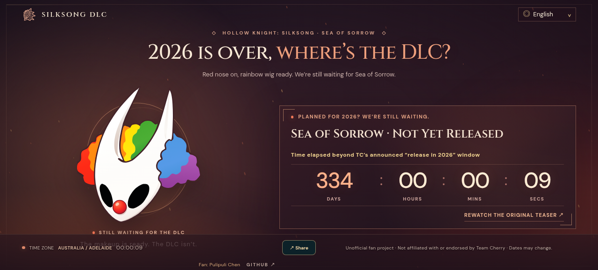
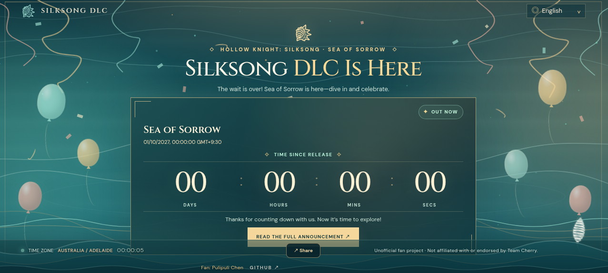

# Demo screenshot history

[English](./demo-history.md) · [繁體中文](../zh_tw/demo-history.md)

This gallery documents the evolution of the countdown website and preserves the meaning of every screenshot stored in `demo/`. Some images show historical countdown choices; others are simulated previews of future states. They are not all screenshots of the current live website.

Older dates such as November 27 and December 31, 2026 were working targets or fan-selected markers at the time. They must not be interpreted as Team Cherry's official DLC release date.

## Historical countdown layouts

### 1. Early dual-countdown: Switch 2 physical edition and year-end marker

File: [`demo_wait_switch_2.png`](../../demo/demo_wait_switch_2.png)

The original two-card layout displayed a retailer-listed **November 27, 2026** date for the *Hollow Knight: Silksong* Switch 2 physical edition, alongside a **December 31, 2026** year-end marker for Sea of Sorrow. The screenshot explicitly described the December 31 date as a fan-selected marker, not an official release date. Whether the DLC would launch alongside the physical edition was speculation only.

### 2. Year-end countdown after the earlier date passed

File: [`demo_wait_2026_end.png`](../../demo/demo_wait_2026_end.png)

After the November 27 countdown had passed and was hidden, the remaining December 31 card was centered on the page. This version kept the year-end marker as a fan-selected estimate and continued to state that it was not an official release date.

### 3. Cherry Time presentation countdown

File: [`demo_wait_cheery_time.png`](../../demo/demo_wait_cheery_time.png)

After Team Cherry announced **Cherry Time**, the page showed a countdown to **November 27, 2026, at 23:00 Taipei time (UTC+8)**, equivalent to **November 28 at 01:30 in Adelaide**. The second card still showed the fan-selected December 31 year-end marker. The screenshot made clear that Cherry Time was a special presentation and was not itself a confirmed DLC release time.

### 4. Official Sea of Sorrow release-date countdown

File: [`demo_wait_1211.png`](../../demo/demo_wait_1211.png)

This is the updated countdown after Team Cherry announced **December 11, 2026** as the Sea of Sorrow release date. Because the exact launch time was not announced, the countdown covers the full December 11 calendar day and ends at **00:00 on December 12 in Australia/Adelaide**. That boundary is the end of the countdown window, not a claim that the DLC launches at midnight. The image also includes links to the original teaser and launch trailer.

## Simulated state previews

### 5. Overdue, but the DLC is not yet released

File: [`demo_dlc_not_released_yet.png`](../../demo/demo_dlc_not_released_yet.png)

This preview demonstrates the overdue state for a scenario in which the announced 2026 release window has ended but the DLC has not been marked as released. It features the original theatrical mask illustration with a rainbow wig and red nose, plus an elapsed-time counter. It is a simulated state preview, not a statement about the DLC's actual availability.

### 6. DLC release celebration

File: [`demo_dlc_released.png`](../../demo/demo_dlc_released.png)

This preview demonstrates the release celebration shown after a maintainer marks the DLC as released. It includes balloons, ribbons, confetti, an elapsed-since-release timer, and an optional announcement link. The displayed **October 1, 2027, 00:00 (Australia/Adelaide)** timestamp is sample preview data, not an official release timestamp.

## Screenshot conventions

- Files in `demo/` are retained as visual records; do not delete or overwrite an older screenshot just because the live design changes.
- A screenshot may show a simulated date or state. Check its caption before treating any displayed date or release status as current.
- The current public countdown is described in the root [README](../../README.md) and [繁體中文 README](../../README_zh_tw.md).
