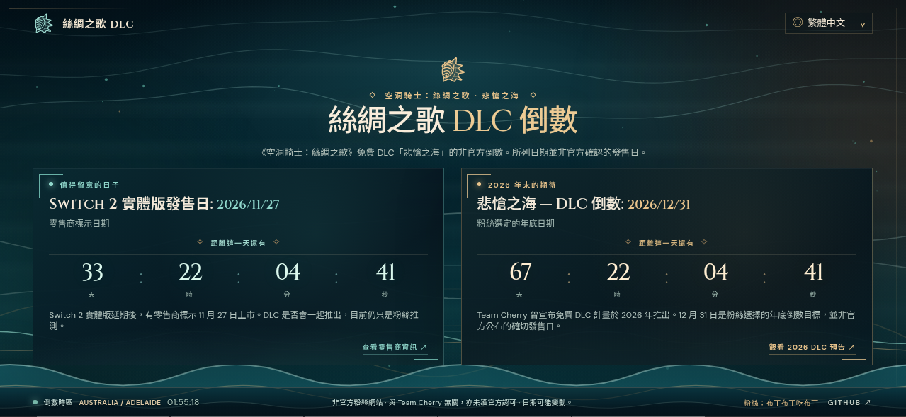
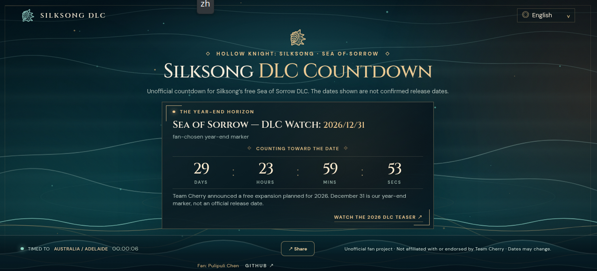
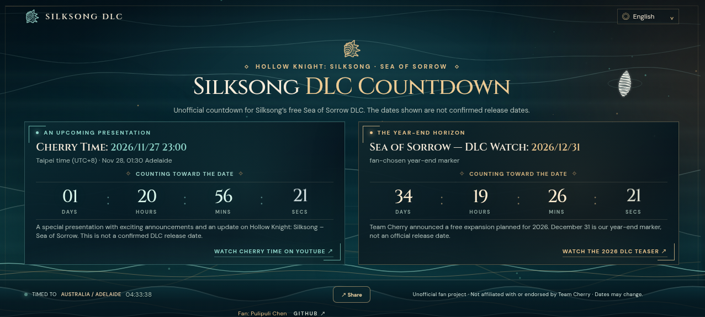
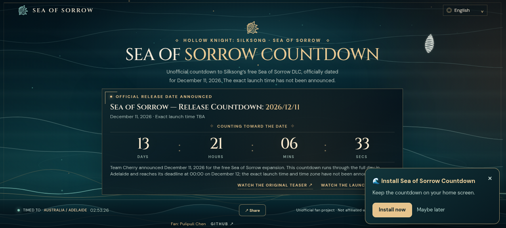
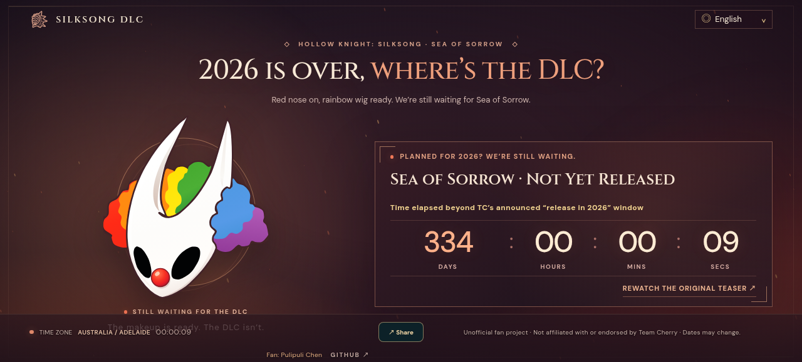
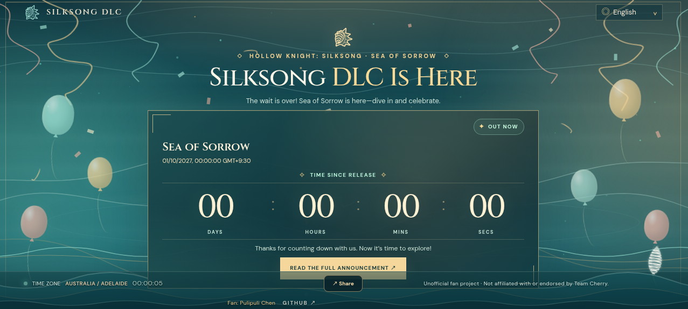

# Demo 畫面歷史紀錄

[English](../en_us/demo-history.md) · [繁體中文](./demo-history.md)

本頁記錄倒數網站的畫面演變，並說明 `demo/` 資料夾中每張截圖的背景。部分圖片是過去使用過的倒數日期，部分則是模擬未來狀態的預覽；它們不全都是目前公開網站的即時畫面。

例如 2026 年 11 月 27 日與 12 月 31 日，都是當時使用的倒數目標或粉絲選定的日期，不應解讀為 Team Cherry 正式公布的 DLC 發售日期。

## 歷史倒數畫面

### 1. 最初的雙倒數：Switch 2 實體版與年底標記

檔案：[`demo_wait_switch_2.png`](../../demo/demo_wait_switch_2.png)

最初的雙卡版面同時顯示兩個目標：一是零售通路標示的《空洞騎士：絲綢之歌》Switch 2 實體版日期 **2026/11/27**；另一個是粉絲選定的《悲愴之海》年底標記 **2026/12/31**。截圖也明確說明 12 月 31 日不是官方發售日期。至於 DLC 是否會與實體版同日推出，當時僅是粉絲推測。

### 2. 先前日期結束後的年底單卡倒數

檔案：[`demo_wait_2026_end.png`](../../demo/demo_wait_2026_end.png)

11 月 27 日的倒數結束並隱藏後，頁面將剩下的 12 月 31 日倒數卡片置中。這個版本仍將年底日期定位為粉絲自行選定的預估標記，並清楚註明它不是官方發售日期。

### 3. Cherry Time 發表會倒數

檔案：[`demo_wait_cheery_time.png`](../../demo/demo_wait_cheery_time.png)

Team Cherry 公布 **Cherry Time** 後，網站新增發表會倒數：**2026/11/27 23:00（臺灣時間 UTC+8）**，相當於**阿德雷德時間 11/28 01:30**。第二張卡片仍保留粉絲選定的 12 月 31 日年底標記。畫面也特別說明 Cherry Time 是一場特別發表會，並非已確認的 DLC 開放時間。

### 4. 官方公布 12 月 11 日後的《悲愴之海》倒數

檔案：[`demo_wait_1211.png`](../../demo/demo_wait_1211.png)

Team Cherry 公布《悲愴之海》將於 **2026/12/11** 推出後，網站改為目前的單卡倒數。由於官方沒有公布具體開放時間，倒數會完整涵蓋 12 月 11 日，並於**阿德雷德時間 12 月 12 日 00:00**結束。這只是倒數期間的結束界線，不代表 DLC 一定在午夜開放。圖片也加入了首支預告與發售預告的連結。

## 模擬狀態預覽

### 5. 已經逾期，但 DLC 尚未發售

檔案：[`demo_dlc_not_released_yet.png`](../../demo/demo_dlc_not_released_yet.png)

這張圖展示一種模擬情境：Team Cherry 原先公布的 2026 年發售窗口已經結束，但維護者仍未將 DLC 標記為已發售。畫面使用戴著彩虹假髮、紅鼻子的原創面具插畫，並顯示逾期經過時間。這是狀態預覽，不代表 DLC 實際發售狀況。

### 6. DLC 正式發售慶祝畫面

檔案：[`demo_dlc_released.png`](../../demo/demo_dlc_released.png)

這張圖展示維護者將 DLC 標記為已發售後的慶祝畫面，包含氣球、彩帶、紙花、發售後經過時間，以及可選擇顯示的公告連結。圖中顯示的 **2027/10/01 00:00（Australia/Adelaide）**只是預覽用的模擬時間，不是官方發售時間。

## 圖片保存原則

- `demo/` 中的圖片作為畫面歷史紀錄保留；即使公開網站設計改變，也不要因為舊畫面不再使用就刪除或覆蓋。
- 截圖可能使用模擬日期或模擬狀態。引用圖片中的日期或發售狀態前，請先閱讀對應說明。
- 目前公開網站的倒數設定，請以根目錄的[英文 README](../../README.md)及[繁體中文 README](../../README_zh_tw.md)為準。
